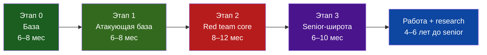

# Red Team Roadmap — 0 → Senior

-   :material-account-hard-hat: **21 модуль**
    ---
    От установки Arch Linux до ADCS, C2 и cloud-атак.

-   :material-flask-outline: **94 лаборатории**
    ---
    Каждая — с командами, ожидаемым результатом и объяснением «почему».

-   :material-clipboard-check-outline: **21 контрольная**
    ---
    По 3 задачи: база / средний / продвинутый. Плюс финальный capstone.

-   :material-briefcase-outline: **Портфолио**
    ---
    Writeup, скрипты, отчёты, детекты — всё складывается в репозиторий.

## Зачем этот трек

Большинство «роадмапов» — это список курсов и книг. Здесь другой подход: **вы учитесь, делая, и каждый шаг оставляет проверяемый артефакт**. Не «посмотрел курс про Kerberoasting», а «поднял домен, получил SPN, закерастоил сервисную учётку, зафиксировал TGS в pcap, написал детект и оформил writeup».

Трек рассчитан на старт с нуля: вы не обязаны знать Linux, сети или программирование. Первый этап — как раз про это. Но и «senior за 3 месяца» здесь не продаётся: см. [честную карту этапов](roadmap.md).

## Маршрут

## С чего начать прямо сейчас

1. Прочитайте [этику и закон](ethics-legal.md) — 10 минут, но это граница между хакером и подследственным.
2. Поставьте Arch Linux по [инструкции](lab/arch-install.md) (или в VMware, если страшно ставить на железо).
3. Соберите стенд по [топологии](lab/vmware-topology.md) под 16 ГБ RAM.
4. Откройте [M00](modules/m00-start/index.md) и сделайте первые три занятия.
5. Заведите `docs/progress.md` и коммитьте каждый артефакт.

## Правила трека

!!! warning "Только своя лаборатория"
    Все атаки — исключительно против собственных виртуальных машин в host-only сети. Никаких чужих сайтов, сетей, «проверок друга» и «заказов с фриланса». Подробнее — [этика и закон](ethics-legal.md).

- **70/30**: не более 30% времени на видео и чтение, не менее 70% — на практику.
- **Воспроизводимость**: если лаба не поднимается с нуля по вашему writeup — она не засчитана.
- **Артефакт на выходе**: скрипт, отчёт, pcap, детект, PoC или разбор. Без артефакта урок не закрыт.
- **Честность**: не копируйте чужие writeup. Сверяться можно, копировать — нет. На собеседовании это видно за 5 минут.

## Что внутри модуля

Каждый модуль — это `index.md` (цель, критерии, карта), уроки `lNN-*.md` и `exam.md`. Урок устроен одинаково:

| Блок | Что внутри |
|---|---|
| Цель и результат | Что вы будете уметь и что должно получиться в конце |
| Теория-минимум | 6–10 тезисов, которых хватит для лабы |
| Лаборатория | Пошагово: подготовка → действия → ожидаемый вывод |
| Почему это работает | Разбор механизма, а не «магия кнопки» |
| Атака и защита | Как это выглядит в реальной операции и как детектится |
| Самопроверка | 3–5 вопросов/проверок без подглядывания |
| Артефакт | Что положить в `labs/` и как назвать |

## Лицензия и вклад

Код — MIT, тексты — CC BY-SA 4.0. Форкайте, адаптируйте под себя, но сохраняйте ссылку на источник. Если нашли ошибку — issue или PR.
