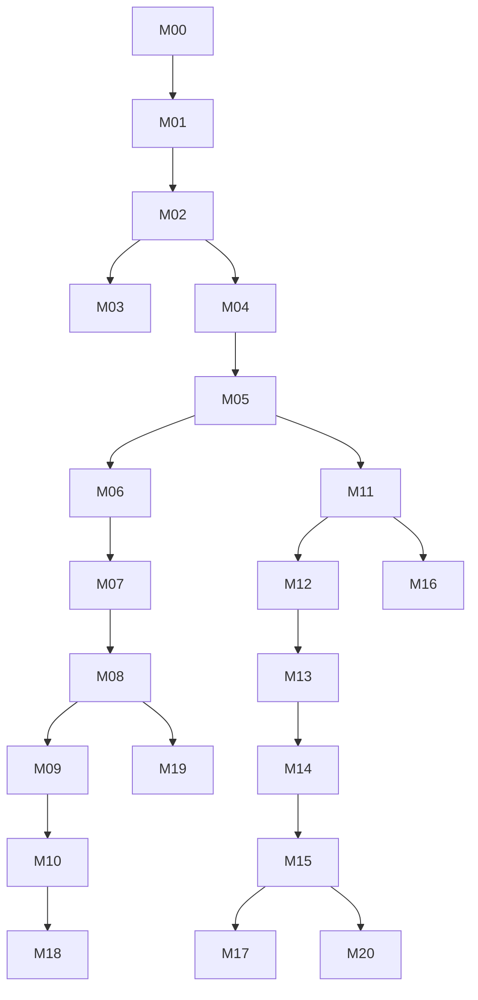

# Модули

Каждый модуль — это `index.md` (цели и критерии), уроки и `exam.md`. Проходите по порядку: модули зависят друг от друга.

## Этап 0 — База

| # | Модуль | Уроков | Ключевой навык |
|---|---|---:|---|
| M00 | [Старт, лаборатория, правила игры](m00-start/index.md) | 3 | Безопасный стенд и дисциплина |
| M01 | [Linux и командная строка](m01-linux/index.md) | 5 | Жить в Arch без GUI |
| M02 | [Сети и протоколы](m02-networking/index.md) | 5 | Читать пакеты и объяснять путь |
| M03 | [Python, Bash, Git](m03-scripting/index.md) | 4 | Автоматизировать и документировать |
| M04 | [Web, HTTP, криптография](m04-web-crypto/index.md) | 5 | Понимать веб и TLS |
| M05 | [Windows и AD: база](m05-windows-ad/index.md) | 5 | Поднять домен и понимать аутентификацию |

## Этап 1 — Атакующая база

| # | Модуль | Уроков | Ключевой навык |
|---|---|---:|---|
| M06 | [Recon и OSINT](m06-recon/index.md) | 4 | Собрать карту цели |
| M07 | [Сетевые атаки и MITM](m07-network-attacks/index.md) | 5 | Перехват и релей |
| M08 | [Web/API-эксплуатация](m08-web-api/index.md) | 6 | Находить и доказывать web-уязвимости |
| M09 | [Сканирование, CVE, эксплуатация](m09-exploitation/index.md) | 4 | От скана до PoC и отчёта |
| M10 | [Повышение привилегий](m10-privesc/index.md) | 5 | Стать root/SYSTEM |

## Этап 2 — Red team core

| # | Модуль | Уроков | Ключевой навык |
|---|---|---:|---|
| M11 | [AD-атаки](m11-ad-attacks/index.md) | 6 | Путь до Domain Admin |
| M12 | [Обход защиты Windows](m12-evasion/index.md) | 5 | Понимать и обходить EDR |
| M13 | [Initial access, фишинг, C2](m13-initial-access-c2/index.md) | 5 | Доставить и удержать доступ |
| M14 | [Pivoting, туннели, инфраструктура](m14-pivoting-infra/index.md) | 4 | Работать через прокси и VPS |
| M15 | [Операции и отчётность](m15-rt-ops/index.md) | 4 | Вести операцию и объяснять риск |

## Этап 3 — Senior-широта

| # | Модуль | Уроков | Ключевой навык |
|---|---|---:|---|
| M16 | [Cloud и Kubernetes](m16-cloud-k8s/index.md) | 4 | Атаковать IAM и K8s |
| M17 | [Detection engineering](m17-detection/index.md) | 4 | Строить детекты и purple-loop |
| M18 | [Hardware, RF, Wi-Fi, OT](m18-hardware-rf-ot/index.md) | 4 | Выйти за пределы IP-сети |
| M19 | [Mobile и реверс](m19-mobile/index.md) | 3 | Разбирать Android-приложения |
| M20 | [Research, tooling, карьера](m20-research-career/index.md) | 4 | Публиковать и расти |

## Зависимости

Нельзя начинать M11 без M05: без домена и понимания Kerberos лабы превращаются в набор команд. Нельзя начинать M12 без M10: нужен доступ к хосту и понимание привилегий.
