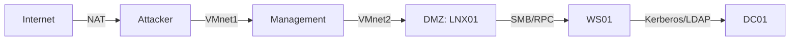

# 6.4 — Карта поверхности атаки и планирование

> **M06 · Этап 1 · 4 ч · 🟡 · артефакт:** `labs/m06-recon/l04-map/`

## Цель

Превратить разрозненные данные в карту, по которой можно планировать атаку и объяснять заказчику, где риск.

## Результат

- `map.md` с активами, сервисами, trust boundaries и приоритетами.
- 5+ гипотез атаки с обоснованием.
- План проверки с ограничениями и MITRE-маппингом.

## Теория

- Поверхность атаки = все точки, через которые можно воздействовать: порты, API, люди, цепочки поставок.
- Trust boundary — граница, где данные переходят из менее доверенной зоны в более доверенную (интернет → DMZ, DMZ → внутренняя сеть, пользователь → админ).
- Приоритет = exposure × impact × likelihood. Не всё, что «critical» по CVSS, важно.
- Гипотеза должна быть проверяемой: «если X, то получим Y, признак Z».
- План фиксирует, что **не** делаем: DoS, соц. инженерия, выход за scope.

## Лаборатория

### 1. Инвентаризация

Заполните таблицу по лаборатории:

| Актив | IP | Роль | Сервисы | Версии | Exposure |
|---|---|---|---|---|---|
| LNX01 | 10.10.10.30 | web | 22, 8000 | OpenSSH 9.x, Python | внутренний |
| DC01 | 10.10.10.10 | AD | 53, 88, 389, 445 | Server 2022 | критичный |
| WS01 | 10.10.10.20 | workstation | 445, 3389 | Windows 11 | пользовательский |
| DVWA | host:8080 | web target | 80 | Apache/PHP | тестовый |

### 2. Trust boundaries

Нарисуйте mermaid:



Отметьте, где нет контроля (например, плоская сеть 10.10.10.0/24).

### 3. Гипотезы

Примеры:

| # | Гипотеза | Проверка | Риск |
|---|---|---|---|
| H1 | DVWA SQLi даёт хэши | SQLi в `id` | Высокий |
| H2 | Пароль БД переиспользован для SSH | вход по найденным кредам | Средний |
| H3 | SMB signing выключен → relay | `nmap --script smb2-security-mode` | Высокий |
| H4 | WS01 admin = локальный админ на DC | pass-the-hash | Критический |
| H5 | Старый backup в webroot | ffuf + скачивание | Средний |

### 4. План проверки

```markdown
## Scope
10.10.10.0/24, окно 2 часа, снапшот pre-attack.

## Шаги
1. H1: ручная SQLi (10 мин), без sqlmap --dump.
2. H2: проверить reuse на LNX01 (5 мин).
3. H3: nmap smb2-security-mode (2 мин).
4. H4: не выполнять без отдельного согласования (разрушительно).

## Стоп-условия
- сервис недоступен > 1 мин;
- неожиданный трафик наружу;
- найден реальный пользовательский контент.
```

### 5. MITRE-маппинг

| Действие | Техника |
|---|---|
| Скан портов | T1046 |
| SQLi | T1190 |
| Pass-the-Hash | T1550.002 |
| Kerberoasting | T1558.003 |

## Атака и защита

- **Атака:** карта показывает кратчайший путь и «дорогие» цели.
- **Детект:** план помогает blue предсказать шум; в отчёте вы покажете, какие логи есть.
- **Фикс:** сегментация, уменьшение поверхности (закрыть порты), устранение переиспользования паролей.

## Самопроверка

- [ ] Что такое trust boundary и где она в вашей лабе?
- [ ] Почему CVSS 9.8 не всегда приоритет №1?
- [ ] Чем гипотеза отличается от «давайте просканируем»?
- [ ] Какие стоп-условия вы бы добавили?

## Дальше

[Контрольная M06](exam.md)
